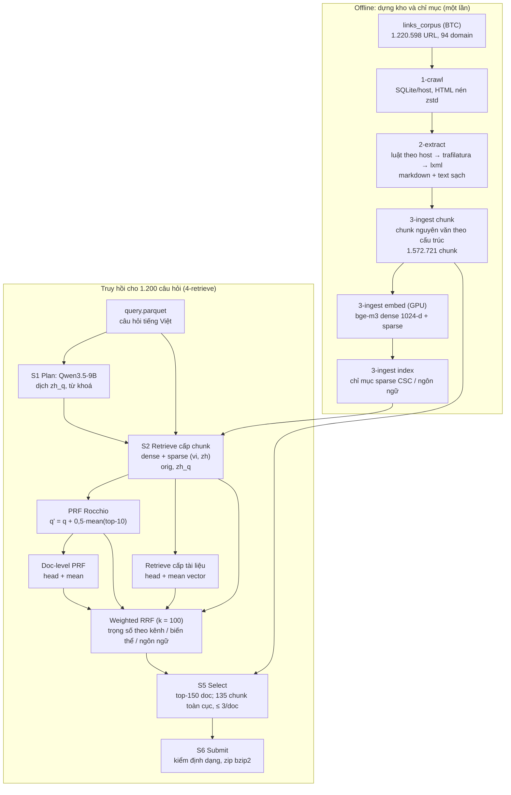

# 1. Tổng quan hệ thống

Hệ thống truy hồi tài liệu y khoa đa ngữ cho R2AI 2026 – Stage 3. Đầu vào là 1.200 câu hỏi tiếng Việt (`query.parquet`). Đầu ra là `submission.json`: với mỗi câu hỏi, một danh sách `relevant_docs` (id tài liệu trong corpus) và `relevant_chunks` (đoạn trích **nguyên văn** từ tài liệu).

## 1.1 Phương pháp

Truy hồi lai (hybrid) dựa hoàn toàn trên **một mô hình nhúng mở `BAAI/bge-m3`**:
- **dense**: vector 1.024 chiều, tìm chính xác bằng nhân ma trận;
- **sparse**: trọng số lexical theo token XLM-R, chỉ mục CSC.

Hai kênh này chạy trên nhiều **biến thể câu hỏi**:
- câu hỏi gốc tiếng Việt;
- bản dịch tiếng Trung do LLM mở Qwen3.5-9B sinh ra;
- câu hỏi mở rộng bằng phản hồi giả (pseudo-relevance feedback, Rocchio);
- truy hồi cấp tài liệu (vector chunk đầu và vector trung bình các chunk của mỗi tài liệu).

Mọi danh sách kết quả được gộp bằng **RRF có trọng số**, rồi chọn tài liệu và đoạn trích theo hạng. Không dùng reranker hay LLM để chấm kết quả: thí nghiệm cho thấy chúng làm điểm thấp đi (xem [4_ket_qua.md](4_ket_qua.md)).

Toàn bộ chạy **offline theo lô**, vì 1.200 câu hỏi là cố định. Không cần server hay vector database: mọi chỉ mục là file `.npy` / `.npz` / `.parquet` được nạp bằng mmap.

## 1.2 Kiến trúc và luồng xử lý

## 1.3 Chức năng các thành phần

| Thư mục | Thành phần | Chức năng |
|---|---|---|
| `1-crawl/` | Thu thập | Tải 1,22 triệu URL của `links_corpus` vào một SQLite cho mỗi host (HTML/XML nén zstd). Thống kê độ phủ: `crawl_stats.csv` |
| `2-extract/` | Trích nội dung | HTML → markdown + text sạch, mỗi id corpus đúng một dòng. Có luật riêng cho từng host, PubMed XML, JSON `__NEXT_DATA__`, fallback trafilatura/lxml; gắn cờ chất lượng |
| `3-ingest/` | Chunk + chỉ mục | Chunk nguyên văn theo cấu trúc (hỏi đáp / bài viết / PubMed); nhúng bge-m3 dense + sparse; gộp chỉ mục sparse |
| `4-retrieve/retrieve/` | Truy hồi | `plan.py` (LLM sinh biến thể câu hỏi), `search.py` (dense, sparse, RRF có trọng số), `select.py` (chọn doc/chunk), `submit.py` (ghi và kiểm định dạng) |
| `4-retrieve/bench/` | Thí nghiệm | `prf.py`, `doc_dense.py`, `doc_dense_prf.py` thêm danh sách kết quả; `variants.py` dựng các cấu hình nộp từ cùng một bộ danh sách |
| `scripts/reproduce.sh` | Tái hiện | Chạy lại toàn bộ chuỗi hoặc chỉ bước cuối |

## 1.4 Xây dựng chỉ mục

1. **Chunk** (`3-ingest/ingest/chunk.py`, đặc tả trong [3-ingest/CHUNKING.md](../3-ingest/CHUNKING.md)):
   - Mọi chunk là đoạn cắt **nguyên văn** từ cột `text`, kèm `spans` vị trí gốc.
   - Cắt theo cấu trúc: heading → ranh giới hỏi/đáp → đoạn văn → câu. Không cắt giữa câu.
   - Bài viết: 500–1.000 từ (tiếng Trung quy đổi 1,6 chữ Hán = 1 từ).
   - Trang hỏi đáp: câu hỏi + câu trả lời trong cùng một chunk; câu trả lời dài thì tách mỗi câu trả lời một chunk, chunk nào cũng chép kèm câu hỏi.
   - PubMed: tiêu đề + abstract.
2. **Nhúng** (`3-ingest/ingest/rag.py`, `BGEM3Encoder`):
   - Đầu vào = tiêu đề + đường dẫn heading + chunk; tối đa 2.048 token; fp16.
   - Đầu ra: vector dense đã chuẩn hoá (lưu float16) và trọng số sparse.
   - Chạy trên GPU T4 qua [3-ingest/colab/embed_colab.ipynb](../3-ingest/colab/embed_colab.ipynb), khoảng 45 chunk/s.
3. **Chỉ mục sparse** (`rag index`): gộp các shard thành ma trận CSC theo từng ngôn ngữ (vi, zh, en), nạp bằng mmap.
4. **Chỉ mục cấp tài liệu** (`bench/doc_dense.py`): tính lúc truy hồi từ chính vector chunk, gồm vector chunk đầu tiên (*head*) và trung bình các chunk của tài liệu đã chuẩn hoá (*mean*).

## 1.5 Truy hồi

Truy hồi chạy theo 4 bước; mỗi bước thêm danh sách top-200 vào `lists.pkl`.

1. **S1 Plan** (`retrieve/plan.py`):
   - Qwen3.5-9B sinh một JSON cho mỗi câu hỏi. Trong đó `zh_q` là bản dịch tiếng Trung viết theo phong cách tiêu đề diễn đàn hỏi đáp.
   - 1.186/1.200 plan hợp lệ. Câu nào lỗi thì chỉ dùng câu gốc.
2. **S2 Retrieve cấp chunk:**
   - Câu gốc (`orig`) và `zh_q` được mã hoá bằng bge-m3 (CPU, có cache).
   - Mỗi biến thể tìm dense trên chỉ mục vi + zh, gộp thành một danh sách theo cosine; tìm sparse trên chỉ mục cùng ngôn ngữ.
   - Lấy top-200 mỗi danh sách.
3. **PRF Rocchio** (`bench/prf.py`): q' = chuẩn hoá(q + 0,5 × trung bình 10 vector chunk đầu của danh sách dense của q). Tìm lại trên chỉ mục dense, tạo biến thể `orig_prf`, `zh_q_prf`.
4. **Truy hồi cấp tài liệu:**
   - `bench/doc_dense.py`: q · head và q · mean cho `orig` và `zh_q`.
   - `bench/doc_dense_prf.py`: tương tự cho các vector PRF q'.
   - Kết quả được ghi theo id `<doc>:0` nên chỉ dùng để **xếp hạng tài liệu**.

## 1.6 Xếp hạng lại (gộp) và lựa chọn đầu ra

**Gộp** (`retrieve/search.py: fuse`, cấu hình `i_dprf15` trong `bench/variants.py`):

score(chunk) = Σ_list w_list / (k + rank), với k = 100.

| Nhóm danh sách | Trọng số |
|---|---|
| `orig` dense / sparse | 1,0 / 0,25 |
| `zh_q`, `orig_prf`, `zh_q_prf` (biến thể không phải câu gốc) | × 0,7 |
| doc-level `orig_head` / `zh_q_head` / `orig_mean` / `zh_q_mean` | 1,25 / 0,833 / 0,75 / 0,5 |
| doc-level PRF `orig_prf_head` / `orig_prf_mean` / `zh_q_prf_head` / `zh_q_prf_mean` | 1,5 / 1,5 / 1,0 / 1,0 |
| Theo ngôn ngữ tài liệu | vi × 1,0; zh × 0,35; en (PubMed) × 0 |

Điểm của tài liệu bằng điểm chunk tốt nhất của nó.

Trọng số ngôn ngữ phản ánh điều dò được trên leaderboard: gold gần như không có PubMed và có ít tài liệu tiếng Trung.

**Lựa chọn** (`retrieve/select.py` + `bench/variants.py`):
- **Tài liệu:** nộp **150 tài liệu** đầu theo điểm gộp. F2 coi recall nặng gấp 4 lần precision, và mỗi câu có khoảng 45 tài liệu gold.
- **Đoạn trích:**
  - Xếp hạng chunk riêng, chỉ dùng các danh sách cấp chunk (`orig`, `zh_q`, `orig_prf`, `zh_q_prf`).
  - Lấy **135 chunk đầu toàn cục** thuộc 150 tài liệu đã chọn, tối đa 3 chunk mỗi tài liệu.
  - Text là chunk nguyên văn.
- **Không ghép chunk dài:** chunk dài làm giảm điểm, vì bộ chấm ghép một chunk nộp với một chunk gold.

**Ghi file** (`retrieve/submit.py`):
- Kiểm tra trước khi ghi: đủ 1.200 câu; id là số nguyên; `doc_id` của mọi chunk nằm trong `relevant_docs`; không có chunk rỗng.
- Nén zip bzip2, khoảng 97 MB.

## 1.7 Các mô-đun đã thử nhưng không dùng trong bài nộp cuối

Mã vẫn nằm trong repo:
- BM25 (`ingest/bm25.py`);
- bộ xếp hạng học (`retrieve/learn.py`);
- LLM judge listwise (`retrieve/judge.py`);
- HyDE (`bench/hyde.py`);
- mô hình nhúng thứ hai multilingual-e5-large (`bench/add_e5.py`);
- reranker cross-encoder (`retrieve/rerank.py`).

Số liệu so sánh nằm ở [4_ket_qua.md](4_ket_qua.md).
