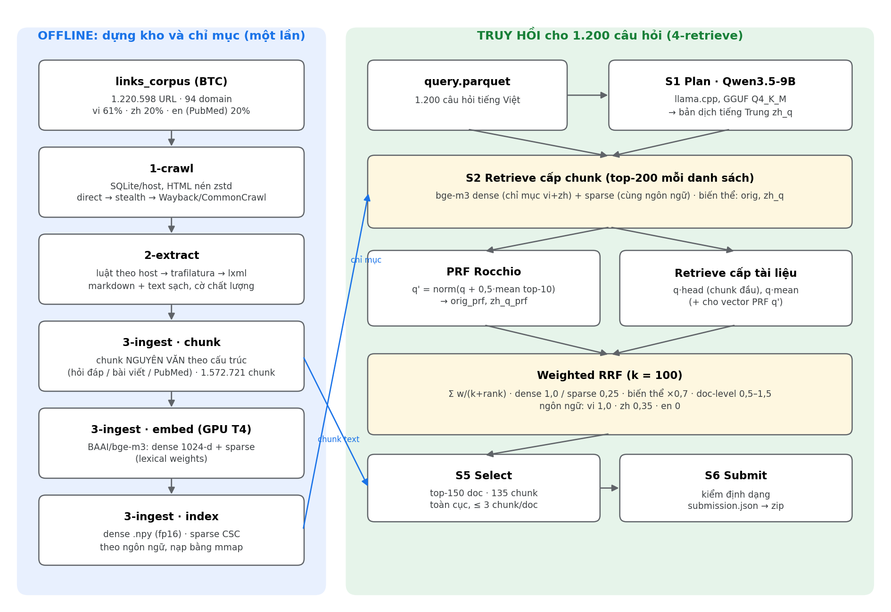

# Thông tin chung và danh mục link

| Mục | Giá trị |
|---|---|
| Bài nộp được báo cáo | `i_dprf15`. Vòng public: FINAL **0,3577** (Docs F2 0,3900; Chunks F2 0,3255), hạng 7/50 |
| Bài nộp vòng private | `i_dprf15`, `j_hh125`, `i_dprf1`, `d12_both075`, và `i_dprf05` (lượt 5) |
| Mã nguồn | [LINK GITHUB] (README.md ở thư mục gốc) |
| Dữ liệu và chỉ mục | Google Cloud Storage `gs://aiguru_crawler`. Link trình duyệt: <https://console.cloud.google.com/storage/browser/aiguru_crawler> (cần tài khoản Google đã được cấp quyền đọc) |
| File tái hiện bài nộp | <https://console.cloud.google.com/storage/browser/aiguru_crawler/release/v1> |
| Checkpoint mô hình | <https://huggingface.co/BAAI/bge-m3> · <https://huggingface.co/unsloth/Qwen3.5-9B-GGUF> (file `Qwen3.5-9B-Q4_K_M.gguf`) |
| Lệnh tái hiện nhanh | `scripts/reproduce.sh fast`, khoảng 15 phút, không cần GPU hay LLM; in ra `IDENTICAL to the released i_dprf15` |

Hệ thống chỉ dùng dữ liệu BTC cung cấp (`links_corpus`, `query.parquet`) và nội dung nhóm tự crawl từ các URL đó. Hai mô hình được dùng đều là mô hình mở ≤ 15B tham số, phát hành trước 01/08/2026, không fine-tune và không gọi API mô hình đóng.

# 1.1. Tổng quan hệ thống

## Phương pháp

Truy hồi lai (hybrid) dựa trên **một mô hình nhúng mở `BAAI/bge-m3`**. Một lần chạy model cho ra hai loại biểu diễn:

- **dense**: vector 1.024 chiều, tìm chính xác bằng nhân ma trận, bắc cầu được giữa các ngôn ngữ;
- **sparse**: trọng số lexical theo token XLM-R, cho truy hồi theo từ khoá.

Mỗi câu hỏi được truy hồi bằng nhiều **biến thể**:

1. câu hỏi gốc tiếng Việt (`orig`);
2. bản dịch tiếng Trung `zh_q` do LLM mở **Qwen3.5-9B** sinh ra, viết theo phong cách tiêu đề diễn đàn hỏi đáp;
3. câu hỏi mở rộng bằng phản hồi giả **Rocchio PRF** (`orig_prf`, `zh_q_prf`);
4. **truy hồi cấp tài liệu**: vector chunk đầu (*head*) và vector trung bình các chunk (*mean*) của mỗi tài liệu, cho cả câu hỏi gốc lẫn câu hỏi PRF.

Các danh sách kết quả được gộp bằng **Reciprocal Rank Fusion có trọng số** (theo kênh, biến thể và ngôn ngữ tài liệu). Sau đó hệ thống chọn 150 tài liệu và 135 đoạn trích nguyên văn cho mỗi câu hỏi.

Toàn bộ chạy **offline theo lô**, vì 1.200 câu hỏi là cố định. Không cần server hay vector database: mọi chỉ mục là file `.npy` / `.npz` / `.parquet` được nạp bằng mmap.

## Kiến trúc chung và luồng xử lý



Luồng xử lý từ câu hỏi đầu vào đến danh sách tài liệu và đoạn trích:

1. **S1 Plan:** Qwen3.5-9B nhận câu hỏi và trả về JSON chứa `zh_q` (cùng từ khoá và thực thể; các trường này không dùng trong bài nộp cuối). Câu nào lỗi thì chỉ dùng câu gốc.
2. **S2 Retrieve cấp chunk:**
   - `orig` và `zh_q` được mã hoá bằng bge-m3.
   - Dense tìm trên chỉ mục vi + zh, gộp thành một danh sách theo cosine; sparse tìm trên chỉ mục cùng ngôn ngữ.
   - Lấy top-200 mỗi danh sách.
3. **PRF:** q' = chuẩn hoá(q + 0,5 × trung bình vector của 10 chunk dense đầu). Tìm lại để tạo `orig_prf`, `zh_q_prf`.
4. **Cấp tài liệu:** tính q · head và q · mean (với cả q và q') trên toàn bộ tài liệu, lấy top-200. Các danh sách này chỉ dùng để xếp hạng tài liệu.
5. **Gộp:** weighted RRF ra điểm cho từng chunk. Điểm tài liệu bằng điểm chunk tốt nhất của nó.
6. **Chọn:** 150 tài liệu đầu. Đoạn trích là 135 chunk đầu toàn cục thuộc các tài liệu đó, tối đa 3 chunk mỗi tài liệu.
7. **Ghi:** `submission.json` được kiểm tra định dạng rồi nén zip.

## Chức năng các thành phần

| Thư mục | Thành phần | Chức năng |
|---|---|---|
| `1-crawl/` | Thu thập | Tải 1,22 triệu URL của `links_corpus` vào một SQLite cho mỗi host. Báo cáo độ phủ ở `1-crawl/report/coverage.md` |
| `2-extract/` | Trích nội dung | HTML/XML → markdown + text sạch, mỗi id corpus đúng một dòng, kèm cờ chất lượng |
| `3-ingest/` | Chunk và chỉ mục | Chunk nguyên văn theo cấu trúc; nhúng bge-m3 dense + sparse; gộp chỉ mục sparse |
| `4-retrieve/retrieve/` | Truy hồi | `plan.py` (S1), `search.py` (dense, sparse, RRF có trọng số), `select.py` (S5), `submit.py` (S6), `llm.py` (client LLM có cache), `encode_cache.py` (cache mã hoá câu hỏi) |
| `4-retrieve/bench/` | Danh sách bổ sung và cấu hình nộp | `prf.py`, `doc_dense.py`, `doc_dense_prf.py`; `variants.py` định nghĩa mọi cấu hình nộp (bài báo cáo: `i_dprf15`) |
| `scripts/reproduce.sh` | Tái hiện | Chạy lại toàn bộ chuỗi (13 bước) hoặc chỉ bước dựng bài nộp |

## Xây dựng chỉ mục

1. **Chunk** (`3-ingest/ingest/chunk.py`; đặc tả trong `3-ingest/CHUNKING.md`):
   - Mọi chunk là đoạn cắt nguyên văn từ cột `text`, kèm `spans` vị trí gốc.
   - Cắt theo cấu trúc: heading → ranh giới hỏi/đáp → đoạn văn → câu. Không cắt giữa câu.
   - Bài viết: 500–1.000 từ (tiếng Trung quy đổi 1,6 chữ Hán = 1 từ).
   - Hỏi đáp: câu hỏi + câu trả lời trong cùng một chunk. Trang nhiều câu trả lời dài thì tách mỗi câu trả lời một chunk, chunk nào cũng chép kèm câu hỏi.
   - PubMed: tiêu đề + abstract.
   - Kết quả: **1.572.721 chunk**.
2. **Nhúng** (`3-ingest/ingest/rag.py`, `BGEM3Encoder`):
   - Đầu vào = tiêu đề + đường dẫn heading + chunk; tối đa 2.048 token; fp16.
   - Lưu vector dense đã chuẩn hoá (float16) và trọng số sparse.
   - Chạy trên GPU T4 bằng notebook `3-ingest/colab/embed_colab.ipynb`, khoảng 45 chunk/s, tức khoảng 10 giờ cho toàn corpus.
3. **Chỉ mục sparse** (`rag index`): gộp các shard thành ma trận CSC cho từng ngôn ngữ.
4. **Chỉ mục cấp tài liệu** (`bench/doc_dense.py`): tính từ chính vector chunk, gồm *head* (chunk đầu) và *mean* (trung bình các chunk, chuẩn hoá L2).

## Truy hồi, xếp hạng lại (gộp) và lựa chọn đầu ra

**Gộp** bằng weighted RRF:

score(chunk) = Σ_danh sách w / (k + hạng), với k = 100.

| Nhóm danh sách | Trọng số w |
|---|---|
| `orig` dense / sparse | 1,0 / 0,25 |
| `zh_q`, `orig_prf`, `zh_q_prf` | × 0,7 so với `orig` |
| Cấp tài liệu `orig_head` / `zh_q_head` / `orig_mean` / `zh_q_mean` | 1,25 / 0,833 / 0,75 / 0,5 |
| Cấp tài liệu PRF `orig_prf_head` / `orig_prf_mean` / `zh_q_prf_head` / `zh_q_prf_mean` | 1,5 / 1,5 / 1,0 / 1,0 |
| Theo ngôn ngữ tài liệu | vi × 1,0; zh × 0,35; en (PubMed) × 0 |

Các trọng số được chọn qua các lần nộp vòng public, mỗi lần chỉ đổi một yếu tố (Phụ lục A). Hệ thống không dùng cross-encoder reranker hay LLM judge, vì thí nghiệm cho thấy chúng làm điểm thấp đi.

**Lựa chọn đầu ra** (`retrieve/select.py`, `bench/variants.py`):

- **Tài liệu:** 150 tài liệu đầu mỗi câu. F2 coi recall nặng gấp 4 lần precision, và ước lượng mỗi câu có khoảng 45 tài liệu đúng.
- **Đoạn trích:**
  - Chunk được xếp hạng riêng, chỉ bằng các danh sách cấp chunk.
  - Lấy 135 chunk đầu toàn cục, tối đa 3 chunk mỗi tài liệu.
  - `chunk_text` là chunk nguyên văn, không ghép và không cắt.
- **Kiểm tra trước khi ghi** (`retrieve/submit.py`): đủ 1.200 câu; id là số nguyên; `doc_id` của mọi chunk nằm trong `relevant_docs`; không có chunk rỗng. File nén zip bzip2, khoảng 97 MB.

# 1.2. Tài liệu mô tả dữ liệu

## Nguồn dữ liệu

| Dữ liệu | Nội dung | Nguồn |
|---|---|---|
| `links_corpus` | 1.220.598 cặp (`id`, `url`) trên 94 domain: vi 740.598, zh 240.000, en (PubMed) 240.000 | BTC |
| `query.parquet` | 1.200 câu hỏi tiếng Việt (`id`, `query`) | BTC |
| Nội dung trang | Nhóm tự crawl từ các URL của `links_corpus` | Bước 1 |

Không dùng dữ liệu ngoài, nhãn tự gán hay tập huấn luyện nào khác.

## Thu thập (crawl)

- **Cách chạy:**
  - URL được chia thành 30 *lane* theo nhóm host. Mỗi lane chạy theo lô 1.000 URL (module `crawler.run_lane`, thư viện scrapling) trên nhiều VM ở các region khác nhau.
  - Kết quả ghi vào một SQLite cho mỗi host: HTML hoặc XML nén zstd, kèm mã HTTP và nguồn.
- **Thứ tự thử nguồn:**

  | Nguồn | Số trang | Cách lấy |
  |---|---|---|
  | `direct` | 889.782 | tải trực tiếp |
  | `efetch` | 239.896 | PubMed: XML qua NCBI E-utilities theo PMID |
  | `wayback_direct` / `wayback` | 73.193 | bản lưu Internet Archive, khi site gốc không còn hoặc chặn |
  | `stealth` | 9.069 | trình duyệt headless cho site chống bot |
  | `mirror` | 5.286 | bản mirror chính thức của site |
  | `commoncrawl` | 3 | CommonCrawl |

- **Độ phủ:**
  - Lấy được **1.217.229 / 1.220.598 URL (99,72%)**. Chi tiết theo host: `1-crawl/report/coverage.md` và `1-crawl/crawl_stats.csv`.
  - Phần thiếu chủ yếu ở zysjonline (1.953 URL, bị Cloudflare chặn) và article.iiyi (632 URL, lỗi HTTP 521).

## Làm sạch (extract)

Mã nguồn ở `2-extract/`, chi tiết trong `2-extract/README.md` và `2-extract/REPORT.md`.

**Thứ tự trích:**
1. parser PubMed XML: tiêu đề, abstract, MeSH, từ khoá;
2. luật XPath riêng cho host: 44 host báo tiếng Việt, 8 host hỏi đáp và 31 host tri thức tiếng Trung;
3. trafilatura, kèm JSON `__NEXT_DATA__` cho site Next.js;
4. lxml.

**Hậu xử lý:**
- Bỏ menu, khối "tin liên quan" và đoạn lặp trong cùng trang.
- Giữ nguyên văn, kể cả mọi câu trả lời của trang hỏi đáp.
- Đoán ngôn ngữ thực của văn bản theo loại ký tự.
- Gắn cờ chất lượng: `empty`, `short` (< 300 ký tự), `fallback`, `archive`, `meta_only`, `replacement_chars`…

**Đầu ra:**
- Mỗi id corpus đúng một dòng: `id`, `url`, `host`, `lang`, `text_lang`, `status`, `title`, `markdown`, `text`, `flags`, `content_sha1`.
- `validate` kiểm tra phủ đủ 1.220.598 id và không có id trùng.

**Kiểm thử:** 159 test trên fixture thật của 84 host. Audit đo recall đoạn văn so với HTML gốc trên 5 trang × 94 host.

## Phân đoạn (chunk)

Tóm tắt các quy tắc (đặc tả đầy đủ ở `3-ingest/CHUNKING.md`):

- **Nguyên văn:**
  - `chunk_text == join_spans(text, spans)`, nên mọi đoạn nộp đi đều cắt từ tài liệu.
  - Span của các chunk liên tiếp phủ kín văn bản, không chừa khe hở.
- **Phân loại tài liệu bằng luật** (host, mẫu URL, dấu hiệu trong markdown): `qa`, `pubmed`, `article`.
- **Đo độ dài bằng từ:** vi/en đếm theo khoảng trắng; zh quy đổi 1,6 chữ Hán = 1 từ; không đếm dấu câu.
- **Tiêu đề không chép vào chunk.** Tiêu đề chỉ ghép vào đầu vào của embedding.
- **Bỏ** tài liệu rỗng hoặc lỗi crawl.

## Hướng dẫn truy cập và sử dụng dữ liệu

Dữ liệu nằm trên Google Cloud Storage, bucket `gs://aiguru_crawler` (project `aiguru26`, region asia-southeast1). Đội cấp quyền đọc (*Storage Object Viewer*) cho tài khoản Google của BTC. Có thể truy cập theo hai cách:

- **Trình duyệt:** <https://console.cloud.google.com/storage/browser/aiguru_crawler>. Mỗi file có link tải dạng `https://storage.cloud.google.com/aiguru_crawler/<đường dẫn>`.
- **Dòng lệnh:** `gcloud storage cp` / `gcloud storage rsync`.

| Đường dẫn | Kích thước | Nội dung | Dùng để |
|---|---|---|---|
| `crawl/db/`, `crawl/manifest.parquet` | 32 GB | trang thô theo host | chạy lại từ bước 2 |
| `clean/v1/docs/<host>/*.parquet` | 2,9 GB | kho văn bản sạch | chạy lại từ bước 3 |
| `ingest/v1/rag/` | 15 GB | `chunks/`, `docs/`, `dense/bge-m3/`, `sparse_index/bge-m3/` | chạy lại từ bước 4 |
| `release/v1/run/plans.json` | 0,6 MB | plan của Qwen3.5-9B cho 1.200 câu hỏi | tái hiện chính xác danh sách |
| `release/v1/run/lists.pkl` | 32 MB | danh sách top-200 cấp chunk | |
| `release/v1/run/lists_docprf.pkl` | 92 MB | toàn bộ danh sách của bài nộp | dựng nhanh bài nộp |
| `release/v1/submissions/*.zip` | 97 MB mỗi file | 5 file đã nộp ở vòng private | đối chiếu |

```bash
gcloud auth login
gcloud storage cp -r gs://aiguru_crawler/release/v1 ./release
gcloud storage rsync -r gs://aiguru_crawler/ingest/v1/rag/chunks ./ingest/rag/chunks
python -c "import pandas as pd; print(pd.read_parquet('ingest/rag/chunks/vi/').head())"
```

Schema của chunk: `chunk_id` (`<doc_id>:<idx>`), `doc_id`, `idx`, `text`, `spans`, `title`, `heading_path`, `doc_type`, `unit_kind`.

# 1.3. Mô hình sử dụng

| Mô hình | Vai trò | Định danh / checkpoint | Cách tải | Chạy |
|---|---|---|---|---|
| **BGE-M3** (568M) | Nhúng chunk và câu hỏi: dense (truy hồi ngữ nghĩa xuyên ngôn ngữ) và sparse (từ khoá) | `BAAI/bge-m3` – <https://huggingface.co/BAAI/bge-m3> | tự tải khi chạy qua `FlagEmbedding==1.4.2`; hoặc `huggingface-cli download BAAI/bge-m3` | corpus: GPU T4; câu hỏi: CPU |
| **Qwen3.5-9B** (9B, open weights, phát hành 10/03/2026) | S1 Plan: dịch câu hỏi sang tiếng Trung (`zh_q`) | GGUF Q4_K_M: <https://huggingface.co/unsloth/Qwen3.5-9B-GGUF> (file `Qwen3.5-9B-Q4_K_M.gguf`, 5,7 GB); bản gốc `Qwen/Qwen3.5-9B` | `curl -L -o qwen3.5-9b-q4km.gguf https://huggingface.co/unsloth/Qwen3.5-9B-GGUF/resolve/main/Qwen3.5-9B-Q4_K_M.gguf` | CPU, llama.cpp server |

Cả hai dùng đúng checkpoint chính thức, **không fine-tune**.

## Cấu hình BGE-M3

**Mã hoá corpus:** `BGEM3FlagModel("BAAI/bge-m3", use_fp16=True)`, `passage_max_length=2048`, `batch_size=32`. Đầu vào = `title + heading_path + chunk_text`.

**Mã hoá câu hỏi:** cùng model, `query_max_length=512`, chạy CPU, cache theo text.

## Cấu hình Qwen3.5-9B và prompt

**Khởi động server:**

```bash
docker run -d --name qwen --network host -v /mnt/llm:/models ghcr.io/ggml-org/llama.cpp:server \
  -m /models/qwen3.5-9b-q4km.gguf -c 16384 -np 4 -t 16 --jinja --reasoning-budget 0 --host 0.0.0.0 --port 8080
```

**Cấu hình gọi** (`retrieve/llm.py`):
- Endpoint OpenAI-compatible `POST http://localhost:8080/v1/chat/completions`, `model=qwen3.5-9b-q4km`.
- `temperature=0`, `max_tokens=1200`, 4 luồng song song; tắt chế độ suy luận.
- Có thể thay bằng bất kỳ server OpenAI-compatible nào phục vụ cùng model, ví dụ vLLM. Khi đó dùng tham số `--llm-url`, `--llm-model`, và key qua biến môi trường `LLM_API_KEY` nếu có.

**Prompt** (`retrieve/plan.py`). System:

```text
Bạn là chuyên gia y khoa song ngữ Việt–Trung–Anh, chuẩn bị truy vấn tìm kiếm cho một kho tài liệu y khoa gồm
bài báo/hỏi đáp tiếng Việt, diễn đàn hỏi đáp và bách khoa tiếng Trung, và tóm tắt PubMed tiếng Anh.
Chỉ trả về MỘT object JSON, không giải thích.
```

User:

```text
Câu hỏi của người bệnh (tiếng Việt):
{q}

Trả về JSON đúng các khoá sau:
{"type": "<một trong: symptom, disease, drug, pregnancy, pediatric, lab_result, nutrition, mental, procedure, other>",
 "vi_kw": "<từ khoá y khoa tiếng Việt, bỏ phần kể lể, giữ chỉ số/tên thuốc>",
 "zh_q": "<câu hỏi bằng tiếng Trung giản thể, viết như tiêu đề diễn đàn hỏi đáp y khoa (120ask, 39问医生)>",
 "zh_kw": "<thuật ngữ y khoa tiếng Trung, cách nhau bằng dấu cách>",
 "en_kw": "<medical English keywords, space separated, no AND/OR/quotes/brackets>",
 "entities": [{"vi": "<tên trong câu hỏi>", "en": "<tên chuẩn/hoạt chất>", "zh": "<tên tiếng Trung>"}],
 "subqs": [<chỉ khi câu hỏi có nhiều ý: mỗi ý là một câu hỏi tiếng Việt ngắn; ngược lại để []>]}
```

**Kết quả:**
- 1.186/1.200 plan hợp lệ. JSON lỗi thì dùng câu gốc.
- Bài nộp cuối chỉ dùng trường `zh_q`.
- Suy luận trên CPU có thể lệch nhẹ giữa các máy, nên đội công bố `release/v1/run/plans.json` để tái hiện chính xác.

## Mô hình đã thử nhưng không dùng trong bài nộp cuối

| Mô hình | Kết quả |
|---|---|
| `intfloat/multilingual-e5-large` (nhúng thứ hai) | ngang ở trọng số 0,5 (0,3472 so với 0,3471); giảm ở trọng số 1,0–1,5 |
| Qwen3.5-9B làm LLM judge listwise | giảm (0,1677 so với 0,1756) |
| Qwen3.5-9B sinh HyDE | ngang ở trọng số 0,3; giảm khi trọng số cao hơn |

# 1.4. Mã nguồn

Repo: [LINK GITHUB].

| Phần | Đường dẫn | Nội dung |
|---|---|---|
| Thu thập | `1-crawl/` | báo cáo độ phủ; mã crawler: [BỔ SUNG] |
| Xử lý dữ liệu | `2-extract/extract/` | `pipeline.py` (luồng trích), `source.py` / `remote_sqlite.py` / `storage.py` (đọc SQLite, GCS), `parsers.py` / `htmlmd.py` / `rules.py` / `hosts/*.py` (parser và luật theo host), `clean.py`, `writer.py`, `validate.py`, `audit.py`; 159 test |
| Phân đoạn và chỉ mục | `3-ingest/ingest/` | `chunk.py` (chunk nguyên văn), `rag.py` (chunk / embed / index CLI, `BGEM3Encoder`), `dense.py`, `sparse.py`, `bm25.py`; `colab/embed_colab.ipynb`; 27 test |
| Truy hồi | `4-retrieve/retrieve/` | `__main__.py` (CLI `run`), `config.py`, `plan.py`, `llm.py`, `search.py`, `select.py`, `submit.py`, `encode_cache.py`; mô-đun thử nghiệm: `judge.py`, `rerank.py`, `learn.py`, `metric.py`; 34 test |
| Danh sách bổ sung và tạo file nộp | `4-retrieve/bench/` | `prf.py`, `doc_dense.py`, `doc_dense_prf.py`, `variants.py` (tạo `submission.zip` cho mọi cấu hình) |
| Cấu hình | `4-retrieve/configs/deep_bge_vizh_k100.json` (lượt truy hồi), `VARIANTS["i_dprf15"]` trong `4-retrieve/bench/variants.py` (gộp và chọn), các `Dockerfile` | |
| Tái hiện | `scripts/reproduce.sh` | 13 bước, từ `images` đến `verify`, và lệnh `fast` |

**Thư viện và phụ thuộc** (đã pin trong `requirements*.txt` và các Dockerfile; Python 3.11.11):

| Bước | Thư viện |
|---|---|
| 2-extract | pyarrow 18.1.0, pandas 2.2.3, trafilatura 2.0.0, lxml 5.3.0, lxml_html_clean 0.4.4, zstandard 0.23.0, apsw 3.51.0.0, gcsfs 2025.10.0, google-auth 2.39.0, requests 2.32.3 |
| 3-ingest | pandas 2.2.3, pyarrow 18.1.0, numpy < 2.1, scipy ≥ 1.11, < 1.15, gcsfs 2025.10.0; GPU: FlagEmbedding 1.4.2 |
| 4-retrieve | torch 2.6.0 (CPU), FlagEmbedding 1.4.2, transformers 4.57.1, pandas 2.2.3, numpy < 2.1, scipy, scikit-learn 1.5.2, rapidfuzz 3.9.7, requests 2.32.3, gcsfs |
| Hạ tầng | Docker ≥ 24, Google Cloud SDK, llama.cpp server (`ghcr.io/ggml-org/llama.cpp:server`) |

# 1.5. Tài liệu hướng dẫn

File `README.md` ở thư mục gốc của repo mô tả đầy đủ các bước. Tóm tắt:

**Yêu cầu môi trường:**
- Linux x86-64 với 16 vCPU, 64 GB RAM, đĩa ≥ 100 GB; Docker; Google Cloud SDK có quyền đọc bucket.
- Bước nhúng corpus cần 1 GPU T4 trong khoảng 10 giờ (Colab hoặc Kaggle là đủ).

**Tái hiện nhanh bài nộp** (khoảng 15 phút):

```bash
git clone [LINK GITHUB] r2ai && cd r2ai
gcloud auth login
mkdir -p ~/data && cp query.parquet ~/data/
sudo docker build -f 4-retrieve/Dockerfile -t r2ai-retrieve:v1 .
scripts/reproduce.sh fast
```

Kết quả: `/mnt/full/variants/i_dprf15/submission.zip`, kèm dòng `IDENTICAL to the released i_dprf15`. Đội đã chạy thử bước này từ image dựng lại theo repo: kết quả trùng khớp 1.200/1.200 câu.

**Chạy lại từ đầu:** `scripts/reproduce.sh full`, hoặc từng bước theo thứ tự:

| # | Bước | Việc | Máy |
|---|---|---|---|
| 0 | `images` | build 3 image Docker | CPU |
| 1 | crawl | đầu ra: `crawl/db/` | nhiều VM |
| 2 | `extract` | kho văn bản sạch + kiểm tra độ phủ | CPU, ~1 giờ / 16 vCPU |
| 3 | `chunk` | chunk nguyên văn | CPU |
| 4 | `embed` | bge-m3 dense + sparse | GPU T4, ~10 giờ |
| 5 | `index` | chỉ mục sparse | CPU |
| 6 | `sync` | chép chỉ mục về đĩa local | |
| 7 | `llm` | tải GGUF, chạy llama.cpp | CPU |
| 8 | `retrieve` | plan + danh sách cấp chunk (`PLANS=…` để dùng plan đã công bố) | CPU |
| 9–11 | `prf`, `doc`, `docprf` | danh sách PRF và cấp tài liệu | CPU |
| 12 | `build` | gộp, chọn, ghi `submission.zip` | CPU, ~2 phút |
| 13 | `verify` | so với file đã nộp | |

**Kiểm thử:** `python -m pytest -q` trong `2-extract/`, `3-ingest/`, `4-retrieve/`. Kết quả: 159, 27 và 34 test đều đạt.

# Phụ lục A. Kết quả và thí nghiệm

**Năm bài nộp vòng private** (điểm đo ở vòng public):

| Bài | FINAL | Docs F2 (P / R) | Chunks F2 (P / R) |
|---|---|---|---|
| **`i_dprf15`** | **0,3577** | 0,3900 (0,242 / 0,577) | 0,3255 (0,228 / 0,448) |
| `j_hh125` | 0,3577 | 0,3902 (0,242 / 0,577) | 0,3253 (0,228 / 0,448) |
| `i_dprf1` | 0,3575 | 0,3897 (0,241 / 0,577) | 0,3253 (0,228 / 0,448) |
| `i_dprf05` | 0,3570 | 0,3894 (0,241 / 0,577) | 0,3247 (0,227 / 0,447) |
| `d12_both075` | 0,3526 | 0,3847 (0,238 / 0,573) | 0,3205 (0,224 / 0,442) |

**Tiến trình cải thiện:**

| Mốc | FINAL |
|---|---|
| BM25 top-100 (vi) | 0,108 |
| hybrid bge-m3 dense + sparse | 0,1756 |
| gắn chunk cho 80 tài liệu | 0,2605 |
| + bản dịch `zh_q`, sparse × 0,25 | 0,3212 |
| + PRF, phân bổ chunk toàn cục | 0,3321 |
| tinh chỉnh trọng số ngôn ngữ, `rrf_k`, số chunk | 0,3471 |
| + danh sách cấp tài liệu | 0,3526 |
| + danh sách cấp tài liệu của vector PRF | **0,3577** |

**Không hiệu quả** (đã bỏ):
- LLM judge listwise;
- BM25;
- bản viết lại câu hỏi bằng LLM (từ khoá, câu hỏi con);
- HyDE;
- mô hình nhúng thứ hai e5;
- cắt ngắn chunk, hoặc ghép chunk thành text dài;
- điểm tài liệu = tổng nhiều chunk.

Chi tiết từng thí nghiệm ở `docs/4_ket_qua.md`.
