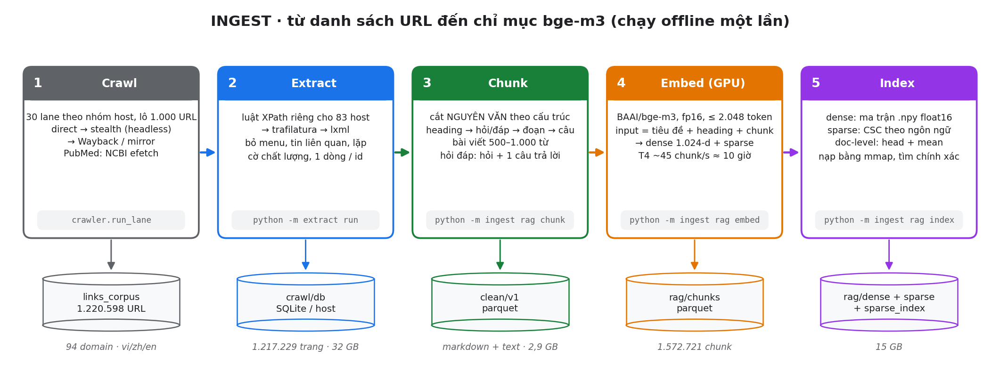
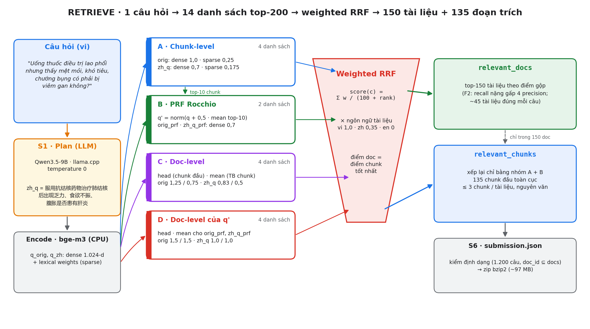

# 1. Đội thi

| | |
|---|---|
| **Tên đội** | **chande** (tài khoản leaderboard: `chande`) |
| **Thành viên** | [Họ tên – vai trò], [Họ tên – vai trò], [Họ tên – vai trò] |
| **Bài toán** | R2AI 2026 – Stage 3: truy hồi tài liệu y khoa đa ngữ (Việt – Trung – Anh) |
| **Kết quả vòng public** | FINAL **0,3577** (Docs F2 0,3900 · Chunks F2 0,3255), hạng **7/50** |
| **Bài nộp được báo cáo** | `i_dprf15` |

Phân công công việc trong đội:

- **Thu thập dữ liệu:** crawl 1,22 triệu URL trên 94 domain.
- **Xử lý dữ liệu:** trích nội dung, phân đoạn, dựng chỉ mục.
- **Truy hồi:** xây pipeline truy hồi, thử nghiệm trên leaderboard.

# 2. Mô hình sử dụng

Hệ thống chỉ dùng **hai mô hình mã nguồn mở**. Cả hai đều ≤ 15B tham số và phát hành trước 01/08/2026. Hai mô hình dùng đúng checkpoint chính thức, **không fine-tune** và **không gọi API mô hình đóng**.

| Mô hình | Vai trò | Checkpoint | Cấu hình chạy |
|---|---|---|---|
| **BGE-M3** (568M) | Nhúng chunk và câu hỏi. Một lần chạy cho ra cả vector **dense** 1.024 chiều (truy hồi ngữ nghĩa, xuyên ngôn ngữ) lẫn trọng số **sparse** (truy hồi từ khoá) | [`BAAI/bge-m3`](https://huggingface.co/BAAI/bge-m3) | `FlagEmbedding 1.4.2`, fp16. Corpus: `passage_max_length=2048`, batch 32, GPU T4. Câu hỏi: `query_max_length=512`, CPU |
| **Qwen3.5-9B** (9B) | Dịch câu hỏi tiếng Việt sang câu hỏi tiếng Trung (`zh_q`) để tìm trong phần corpus tiếng Trung | [`unsloth/Qwen3.5-9B-GGUF`](https://huggingface.co/unsloth/Qwen3.5-9B-GGUF), file `Qwen3.5-9B-Q4_K_M.gguf` (lượng tử hoá từ `Qwen/Qwen3.5-9B`) | llama.cpp server, ngữ cảnh 16.384, 4 slot, `temperature=0`, `max_tokens=1200`, tắt suy luận |

**Prompt của Qwen3.5-9B** (`4-retrieve/retrieve/plan.py`):

```text
[system]
Bạn là chuyên gia y khoa song ngữ Việt–Trung–Anh, chuẩn bị truy vấn tìm kiếm cho một kho tài liệu y khoa gồm
bài báo/hỏi đáp tiếng Việt, diễn đàn hỏi đáp và bách khoa tiếng Trung, và tóm tắt PubMed tiếng Anh.
Chỉ trả về MỘT object JSON, không giải thích.

[user]
Câu hỏi của người bệnh (tiếng Việt):
{q}

Trả về JSON đúng các khoá sau:
{"type": "<một trong: symptom, disease, drug, pregnancy, pediatric, lab_result, nutrition, mental, procedure, other>",
 "vi_kw": "<từ khoá y khoa tiếng Việt, bỏ phần kể lể, giữ chỉ số/tên thuốc>",
 "zh_q": "<câu hỏi bằng tiếng Trung giản thể, viết như tiêu đề diễn đàn hỏi đáp y khoa (120ask, 39问医生)>",
 "zh_kw": "<thuật ngữ y khoa tiếng Trung, cách nhau bằng dấu cách>",
 "en_kw": "<medical English keywords, space separated, no AND/OR/quotes/brackets>",
 "entities": [{"vi": "<tên trong câu hỏi>", "en": "<tên chuẩn/hoạt chất>", "zh": "<tên tiếng Trung>"}],
 "subqs": [<chỉ khi câu hỏi có nhiều ý: mỗi ý là một câu hỏi tiếng Việt ngắn; ngược lại để []>]}
```

Kết quả: 1.186/1.200 câu ra JSON hợp lệ; câu lỗi thì chỉ dùng câu gốc. Bài nộp cuối chỉ dùng trường `zh_q`.

# 3. Tổng quan hệ thống

## 3.1. Bối cảnh và mục đích cuộc thi

Người bệnh Việt Nam thường đặt câu hỏi sức khoẻ bằng ngôn ngữ đời thường. Trong khi đó, tri thức y khoa trả lời được những câu hỏi ấy nằm rải rác trong báo chí, diễn đàn hỏi đáp và bách khoa bằng cả tiếng Việt lẫn tiếng Trung, cùng các bài tóm tắt PubMed tiếng Anh.

Stage 3 của R2AI 2026 yêu cầu xây hệ thống: với mỗi câu hỏi trong 1.200 câu tiếng Việt, trả về các tài liệu liên quan trong kho 1,22 triệu URL, kèm các **đoạn trích nguyên văn** làm bằng chứng.

Điểm số là trung bình của F2 cấp tài liệu và F2 cấp đoạn trích, tính macro theo câu hỏi. Vì F2 coi recall nặng gấp 4 lần precision, bài toán thiên về **tìm đủ** hơn là chỉ tìm đúng.

## 3.2. Tổng quan phương pháp và công nghệ

**Ý tưởng chính:** dùng một mô hình nhúng đa ngữ mạnh (bge-m3) cho cả hai kênh dense và sparse. Sau đó tăng độ phủ bằng cách hỏi cùng một câu theo nhiều cách:

- câu gốc tiếng Việt;
- bản dịch tiếng Trung;
- câu hỏi đã mở rộng bằng phản hồi giả (Rocchio PRF);
- hỏi ở cấp chunk và hỏi thẳng ở cấp tài liệu.

Mỗi cách hỏi cho một danh sách xếp hạng. Các danh sách được gộp bằng **Reciprocal Rank Fusion có trọng số**.

Hệ thống không cần huấn luyện mô hình nào. Toàn bộ chạy **offline theo lô** trên CPU, chỉ riêng bước nhúng corpus cần GPU.

| Lớp | Công nghệ |
|---|---|
| Thu thập | Python, scrapling, trình duyệt headless (site chống bot), Internet Archive Wayback, NCBI E-utilities (PubMed); lưu SQLite + zstd |
| Trích và làm sạch | trafilatura 2.0, lxml 5.3, luật XPath theo host, pyarrow / parquet |
| Mô hình | BGE-M3 qua FlagEmbedding 1.4.2 (PyTorch 2.6); Qwen3.5-9B GGUF qua llama.cpp |
| Chỉ mục và tìm kiếm | NumPy (ma trận dense float16, nhân ma trận chính xác), SciPy (ma trận sparse CSC), mmap. Không dùng vector database |
| Hạ tầng | Docker (3 image: extract / ingest / retrieve), Google Cloud Storage, VM GCP 16 vCPU, Google Colab T4 cho bước nhúng |

Hệ thống gồm hai pha:

- **Ingest** dựng kho văn bản và chỉ mục, chạy một lần.
- **Retrieve** trả lời 1.200 câu hỏi, chạy trong vài phút khi đã có chỉ mục và plan.

## 3.3. Phương pháp chính

### 3.3.1. Ingest: từ danh sách URL đến chỉ mục



**Diễn giải luồng:**

1. **Crawl.** 1.220.598 URL của `links_corpus` được chia thành 30 lane theo nhóm host. Mỗi URL thử lần lượt các nguồn:

   | Nguồn | Số trang | Cách lấy |
   |---|---|---|
   | Tải trực tiếp | 889.782 | |
   | NCBI efetch | 239.896 | PubMed: XML theo PMID |
   | Internet Archive | 73.193 | bản lưu, khi site gốc không còn hoặc chặn |
   | Trình duyệt headless | 9.069 | site chống bot |
   | Mirror | 5.286 | bản mirror của site |

   Kết quả: 1.217.229 trang (99,72%), lưu trong một SQLite cho mỗi host.
2. **Extract.** Mỗi trang đi qua các bộ trích theo thứ tự:
   1. parser PubMed XML;
   2. luật XPath riêng cho 83 host;
   3. trafilatura, kèm JSON `__NEXT_DATA__` cho site Next.js;
   4. lxml.

   Sau đó bỏ menu, khối "tin liên quan" và đoạn lặp; giữ đủ mọi câu trả lời ở trang hỏi đáp; gắn cờ chất lượng (`short`, `fallback`, `archive`…). Mỗi id corpus có đúng một dòng `markdown` + `text`.
3. **Chunk.** Cột `text` được cắt **nguyên văn**: mỗi chunk lưu `spans` vị trí gốc và `chunk_text == join_spans(text, spans)`, nên đoạn trích nộp đi luôn là chuỗi con của tài liệu. Quy tắc cắt theo loại tài liệu:

   | Loại | Cách cắt |
   |---|---|
   | Bài viết | theo heading → đoạn → câu, 500–1.000 từ (zh: 1,6 chữ Hán = 1 từ) |
   | Hỏi đáp | 1 chunk = câu hỏi + câu trả lời. Trang nhiều câu trả lời dài (> 600 từ) thì tách mỗi câu trả lời một chunk, chunk nào cũng kèm câu hỏi |
   | PubMed | tiêu đề + abstract |

4. **Embed.** Đầu vào của bge-m3 là tiêu đề + đường dẫn heading + chunk. Tiêu đề giúp mô hình hiểu ngữ cảnh nhưng không nằm trong đoạn trích. Đầu ra gồm vector dense đã chuẩn hoá L2 (lưu float16) và trọng số lexical.
5. **Index.** Vector dense lưu thành ma trận `.npy` theo shard; trọng số sparse gộp thành ma trận CSC cho từng ngôn ngữ. Lúc truy hồi, hệ thống tính thêm hai vector cấp tài liệu từ chính vector chunk: **head** (chunk đầu, thường gồm tiêu đề và sapo) và **mean** (trung bình các chunk, chuẩn hoá lại).

**Cấu hình:**

```yaml
chunk:   {article: {min_words: 500, max_words: 1000}, qa_split_words: 600, zh_chars_per_word: 1.6,
          boundaries: [heading, qa, paragraph, sentence]}
embed:   {model: BAAI/bge-m3, fp16: true, passage_max_length: 2048, batch_size: 32,
          input: "title \n heading_path \n chunk_text", output: [dense_1024_fp16, lexical_weights]}
index:   {dense: "rag/dense/bge-m3/<lang>/*.npy", sparse: "rag/sparse_index/bge-m3/<lang>/ (CSC)",
          doc_level: [head, mean]}
```

**Ví dụ một chunk** (tài liệu 568969, tiếng Việt):

```json
{"chunk_id": "568969:0", "doc_id": 568969, "idx": 0, "doc_type": "article",
 "title": "VIÊM GAN DO SỬ DỤNG THUỐC KHÁNG LAO",
 "spans": [[0, 4192]],
 "text": "Bệnh Lao do các chủng mycobacterium tuberculosis gây ra được điều trị hiệu quả bằng các thuốc chống lao hàng đầu. Tuy nhiên, hầu hết các loại thuốc kháng lao được biết là gây độc cho gan, …"}
```

**Số liệu:**

| Kho | Kích thước |
|---|---|
| crawl | 32 GB |
| văn bản sạch | 2,9 GB |
| chunk | 1.572.721 |
| chỉ mục | 15 GB |

### 3.3.2. Retrieve: từ câu hỏi đến tài liệu và đoạn trích



**Diễn giải luồng:**

1. **Plan (LLM).** Qwen3.5-9B dịch câu hỏi sang tiếng Trung theo phong cách tiêu đề diễn đàn (`zh_q`), để khớp với các trang hỏi đáp tiếng Trung như 120ask hay 39.net.
2. **Encode.** Câu gốc `q_orig` và bản dịch `q_zh` được mã hoá bằng bge-m3, cho ra vector dense và trọng số sparse.
3. **Bốn nhóm danh sách,** mỗi danh sách lấy top-200:
   - **A – cấp chunk:** dense trên chỉ mục vi + zh (gộp theo cosine) và sparse trên chỉ mục cùng ngôn ngữ, cho cả `orig` và `zh_q`.
   - **B – PRF Rocchio:** tạm coi 10 chunk dense đầu là đúng, kéo vector câu hỏi về phía chúng: `q' = norm(q + 0,5 · mean(top-10))`, rồi tìm lại. Cách này thêm vào câu hỏi các thuật ngữ chuyên môn mà câu hỏi đời thường thiếu.
   - **C – cấp tài liệu:** so `q` trực tiếp với vector head và mean của từng tài liệu. Nhóm này ưu tiên tài liệu mà *toàn bài* nói về chủ đề, thay vì chỉ một đoạn.
   - **D – cấp tài liệu của q':** như nhóm C, nhưng dùng vector PRF.
4. **Weighted RRF.** Mỗi chunk được cộng điểm từ mọi danh sách có chứa nó: `score = Σ w / (100 + hạng)`, sau đó nhân với trọng số ngôn ngữ của tài liệu. Điểm tài liệu bằng điểm chunk tốt nhất của nó. Các danh sách cấp tài liệu (nhóm C, D) chỉ trỏ vào chunk đầu, nên chỉ ảnh hưởng tới thứ hạng tài liệu.
5. **Chọn đầu ra.**
   - **Tài liệu:** 150 tài liệu đầu.
   - **Đoạn trích:** xếp hạng lại chỉ bằng nhóm A + B, vì đó là các tín hiệu ở cấp đoạn. Lấy 135 chunk đầu toàn cục thuộc 150 tài liệu đó, tối đa 3 chunk mỗi tài liệu. Mỗi đoạn là nguyên văn một chunk, không ghép, không cắt.

**Vì sao chọn các con số này:**

- **150 tài liệu:** mỗi câu hỏi có khoảng 45 tài liệu đúng, và F2 thưởng recall.
- **Tiếng Anh (PubMed) nhân 0:** gold không có tài liệu PubMed.
- **Tiếng Trung nhân 0,35:** gold có ít tài liệu tiếng Trung.

Mọi trọng số được chọn bằng các lần nộp ở vòng public, mỗi lần chỉ đổi một yếu tố. Reranker cross-encoder, LLM judge, HyDE và mô hình nhúng thứ hai (e5) đều đã được thử và bị loại vì không cải thiện điểm.

**Cấu hình của bài nộp `i_dprf15`** (`4-retrieve/configs/deep_bge_vizh_k100.json` cho lượt truy hồi, `VARIANTS["i_dprf15"]` trong `4-retrieve/bench/variants.py` cho gộp và chọn; dưới đây đã trải phẳng):

```python
# lượt truy hồi
dense_langs = ["vi", "zh"];  sparse_langs = ["vi", "zh"];  k_dense = k_sparse = 200
prf = dict(n=10, alpha=0.5);  doc_level_k = 200
# gộp
rrf_k = 100
w_dense, w_sparse = 1.0, 0.25          # theo kênh
w_trans = 0.7                          # zh_q, orig_prf, zh_q_prf so với orig
variant_weight = {"orig_head": 1.25, "zh_q_head": 0.833, "orig_mean": 0.75, "zh_q_mean": 0.5,
                  "orig_prf_head": 1.5, "zh_q_prf_head": 1.0, "orig_prf_mean": 1.5, "zh_q_prf_mean": 1.0}
lang_weight = {"vi": 1.0, "zh": 0.35, "en": 0.0}
# chọn
k_docs = 150                           # relevant_docs
chunk_lists = ["orig", "zh_q", "orig_prf", "zh_q_prf"]   # chỉ nhóm A + B
chunk_global, k_chunks_per_doc = 135, 3                  # relevant_chunks
```

**Ví dụ: câu hỏi số 13**

> *"Uống thuốc điều trị lao phổi nhưng thấy người mệt mỏi, ăn uống khó tiêu, chướng bụng có phải bị viêm gan không?"*

*Bước 1 – Plan* (trích từ `plans.json`):

```json
{"type": "symptom",
 "zh_q": "服用抗结核药物治疗肺结核后出现乏力、食欲不振、腹胀是否患有肝炎",
 "entities": [{"vi": "thuốc điều trị lao phổi", "en": "anti-tuberculosis medication", "zh": "抗结核药物"}, "…"]}
```

*Bước 2–3 – 14 danh sách.* Ba kết quả đầu của một số danh sách:

| Danh sách | Nhóm | Top-3 (`doc:chunk`) |
|---|---|---|
| `orig` dense | A | 277870:0 · 554196:0 · 568969:0 |
| `orig` sparse | A | 277870:0 · 135240:1 · 568969:1 |
| `zh_q` dense | A | 2390048:0 · 2370138:0 · 2941973:0 |
| `orig_prf` dense | B | 568969:0 · 554196:0 · 277870:0 |
| `orig_mean` | C | 568969:0 · 277870:0 · 522515:0 |
| `orig_prf_mean` | D | 568969:0 · 522515:0 · 275481:0 |

PRF và các danh sách cấp tài liệu đều đẩy tài liệu 568969 (bài chuyên đề "Viêm gan do sử dụng thuốc kháng lao") lên đầu, trong khi danh sách dense của câu gốc chỉ xếp nó thứ 3.

*Bước 4–5 – kết quả nộp:* 150 tài liệu (143 vi, 7 zh) và 135 đoạn trích.

| Hạng | doc_id | Tiêu đề |
|---|---|---|
| 1 | 568969 | VIÊM GAN DO SỬ DỤNG THUỐC KHÁNG LAO |
| 2 | 277870 | Uống thuốc lao bị mệt có nguy hiểm không? |
| 3 | 554196 | Tổn thương gan do dùng isoniazid |
| 4 | 551684 | Thuốc chống lao có thể gây độc cho gan |
| 5 | 509817 | Đang điều trị lao có nên uống thuốc bổ gan? |
| 135 | 2390048 | 肺结核药物性肝炎症状是什么 *(triệu chứng viêm gan do thuốc lao)* |
| 138 | 2370138 | 抗结核药物造成肝损害的症状 *(triệu chứng tổn thương gan do thuốc chống lao)* |

Các tài liệu tiếng Trung chỉ xuất hiện nhờ bản dịch `zh_q`. Chúng đứng cuối danh sách vì bị nhân trọng số 0,35. Đoạn trích đầu tiên là chunk `568969:0` ở trên.

# 4. Tham khảo

Mã nguồn, dữ liệu, checkpoint và hướng dẫn cài đặt, chạy lại: **<https://github.com/quaqducc/r2ai-stage3-medical-retrieval>** (xem `README.md`).
